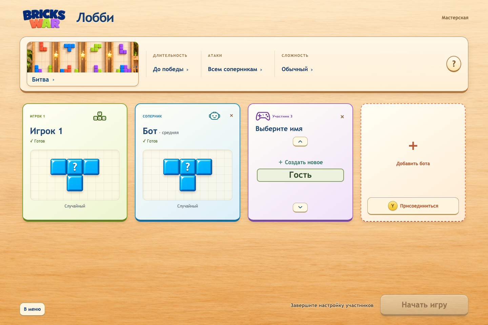
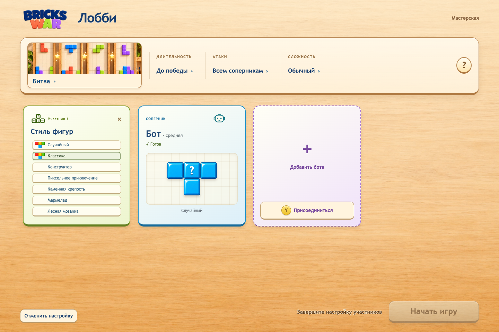
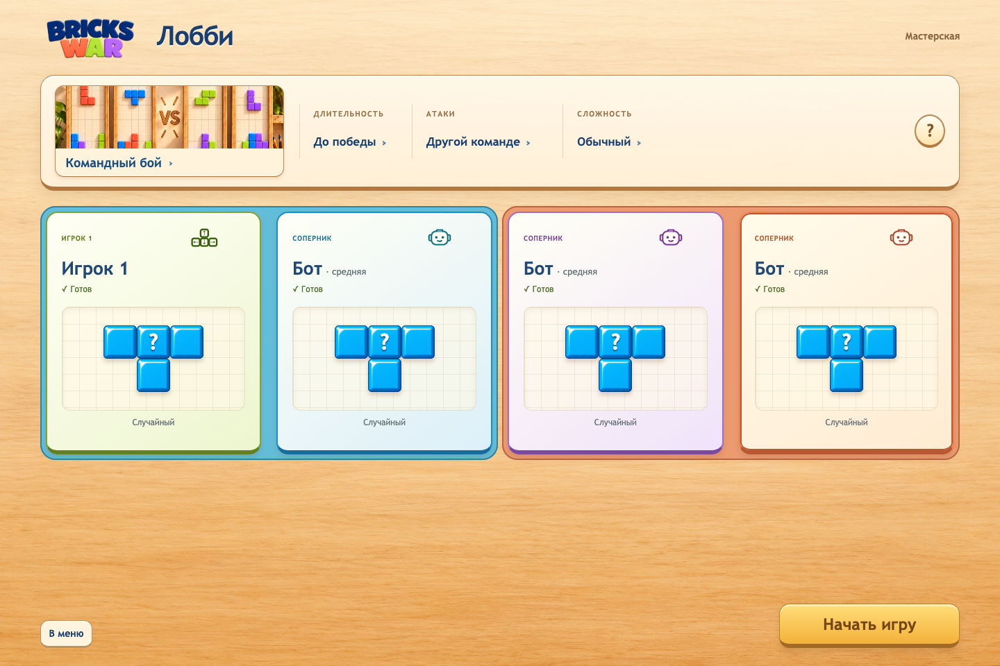
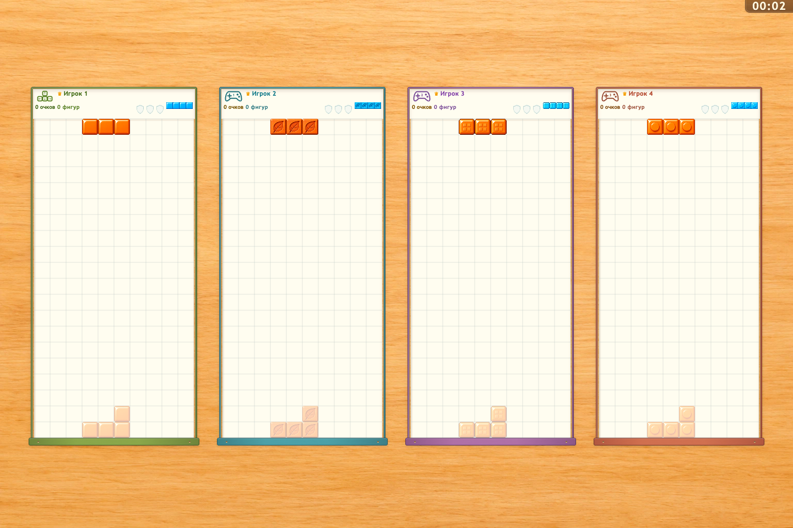

# Bricks War 1.12.1

## Русский

### Улучшения

- Общим меню управляет только клавиатура с мышью или конкретный геймпад, с которого вошли в лобби.
- Подключённые игроки меняют только собственные настройки.
- Короткое Y перемещает игрока в следующий слот, пропуская людей и меняясь местами с ботом.
- Удержание Y открывает редактор своего участника.
- Имя выбирается в колесе нажатием на имя или A; «Гость» создаёт карточку «Игрок N», «Создать новое» открывает ввод.
- Ввод имени сразу получает клавиатурный фокус; Enter применяет имя, Escape отменяет ввод.
- Темы выбираются кликом в списке для мыши и колесом с A для геймпада.
- Вся свободная карточка добавляет бота; присоединение по Y остаётся отдельной кнопкой.
- Подсказки A/B/X/Start зависят от устройства владельца меню; Y для присоединения видна всегда, X оформлена синей кнопкой.
- Убраны лишние подсказки под участниками, подпись темы прижата к низу изображения.
- У выделения параметров матча добавлены внутренние отступы.
- Для фокуса параметров матча выбран светлый шалфей.
- Выделения главного меню и лобби приведены к одному стилю; при смене устройства устаревший фокус очищается.
- Фоны команд стали контрастнее.
- Фокус обводит всю карточку без замены её цвета; наведение слегка меняет исходный оттенок.

### Исправления

- Фокус справки по режиму хорошо заметен вокруг кнопки вопроса.
- Размеры карточек фиксированы внутри каждого адаптивного режима и не скачут при смене содержимого.
- В выборе темы и сложности бота остаётся одно выделение, без отдельной галочки текущего значения.
- Вопрос в случайном стиле фигур выровнен по центру своей плитки.
- Стрелки колёс выровнены по центру кнопок.
- У крестика удаления убран постоянный круг; индикатор появляется только во время удержания.
- Убрано повторное резервирование боковых отступов локальной арены: четыре поля крупнее, расстояния между основаниями сохранены.

## English

### Improved

- Shared menu control belongs to the keyboard/mouse or exact gamepad that entered the lobby.
- Joined players edit only their own settings.
- Tap Y to move to the next slot, skipping humans and swapping with bots.
- Hold Y to edit your participant.
- Choose a name in the wheel by clicking it or pressing A; Guest creates Player N, and Create new opens text entry.
- Name entry receives keyboard focus immediately; Enter applies the name and Escape cancels input.
- Choose themes directly from a mouse list or a gamepad wheel with A.
- The empty card adds a bot across its area; Y join remains a separate button.
- A/B/X/Start hints follow the menu owner device; Y join stays visible, and X uses a blue button.
- Removed extra participant hints and aligned the theme caption to the bottom of the artwork.
- Match parameter focus has comfortable inner padding.
- Match parameter focus uses light sage.
- Main menu and lobby focus share one style; changing input devices clears stale focus.
- Team backgrounds have stronger contrast.
- Focus frames the whole card while preserving its color; hover gently changes its original tint.

### Fixed

- Mode help focus is clearly visible around the question button.
- Card dimensions stay fixed within each responsive layout as their content changes.
- Theme and bot difficulty choices show one focus, with no separate current-value checkmark.
- The random theme question mark is centered in its tile.
- Wheel arrows are centered within their buttons.
- The delete cross has no permanent circle; progress appears only while holding.
- Removed duplicate horizontal reserve in the local arena: four boards are larger while pedestal spacing stays intact.

## Verification

- Focused arena layout tests: PASS.
- Local runtime matrix: 17 supported scenarios PASS; menu/lobby captures at 1440 and 390 px: PASS.
- Full suite, physical controllers and installed desktop update acceptance: NotRun.
