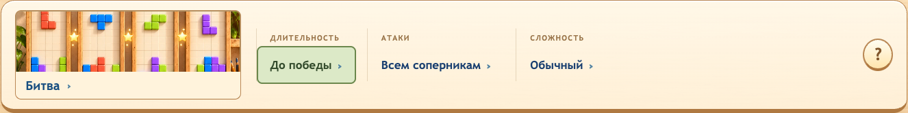
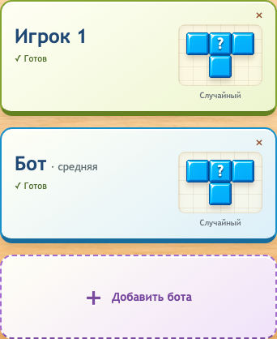

# Bricks War 1.13.1

## Русский

### Улучшения

- Настройки матча, переключатель режима и кнопка правил получили более заметную единую подсветку для мыши, клавиатуры и геймпада.

  

### Исправления

- Карточки участников на телефонах стали компактными и подстраиваются под содержимое; длинные имена остаются читаемыми.

  

- В карточках на телефоне убраны значок устройства и повторная подпись над именем.
- На телефоне пустой слот предлагает добавить бота; кнопка входа второго игрока скрыта.

## English

### Improved

- Match settings, the mode switch and the rules button now share a clearer highlight for mouse, keyboard and gamepad navigation.

  

### Fixed

- Player cards on phones now fit their contents, with compact spacing and readable long names.

  

- Removed the redundant device icon and repeated label above player names on phones.
- Empty slots on phones offer adding a bot; the unavailable second-player Join button is hidden.
