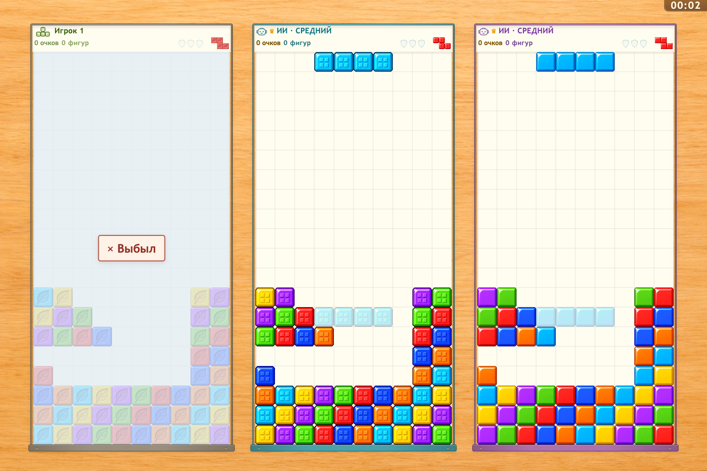
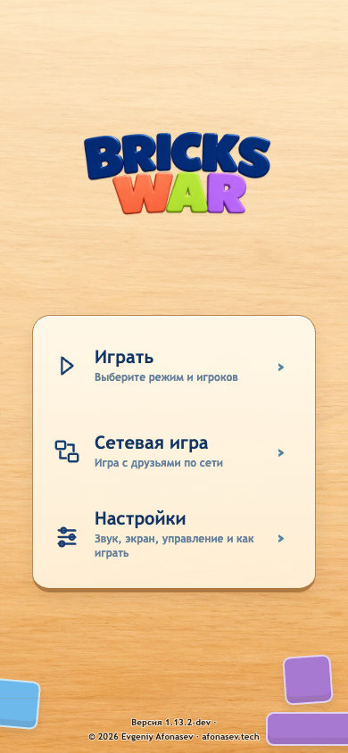
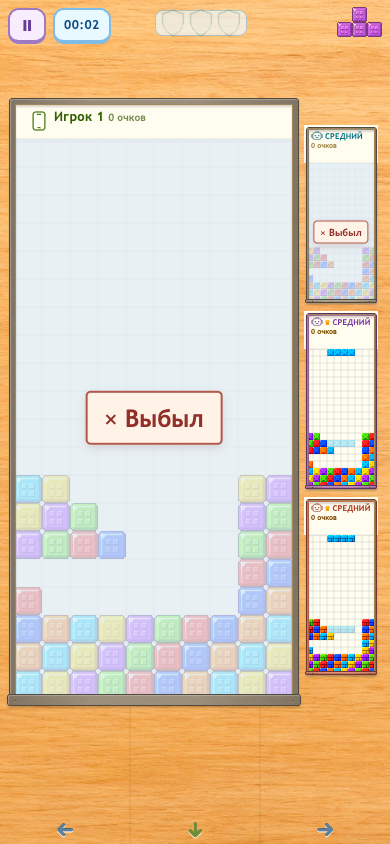

# Bricks War 1.13.2

## Русский

### Улучшения

- Выбывание теперь отмечается заметной плашкой «× Выбыл» в центре своего поля.

  

- Версия игры и подпись автора в меню получили тёмный текст с тонким светлым контуром для лучшей читаемости на дереве.

  

### Исправления

- Выбывшее поле бледнеет целиком; активная фигура и её тень больше не остаются видимыми.
- Подписи ИИ на телефоне помещаются внутри рамок как у живых, так и у выбывших игроков.

  

## English

### Improved

- Elimination is now marked by a clear “× Eliminated” plaque in the center of the player's board.

  

- The menu version and author credits now use dark text with a fine light outline for clearer reading on wood.

  

### Fixed

- Eliminated boards fade as a whole; their active piece and ghost no longer remain visible.
- Phone AI labels now stay inside their frames for both active and eliminated players.

  
