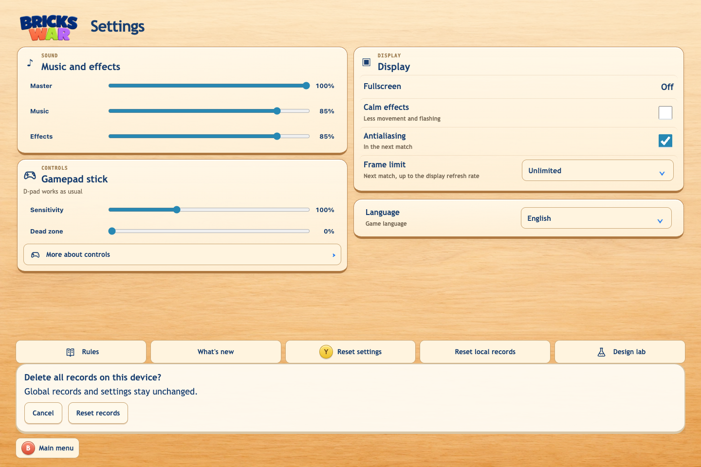
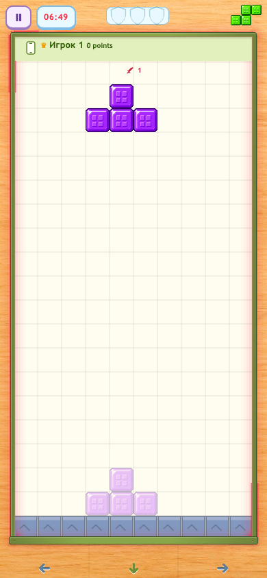
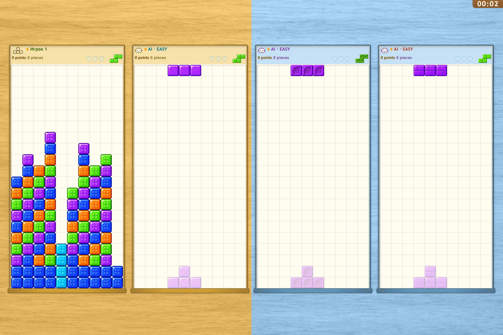
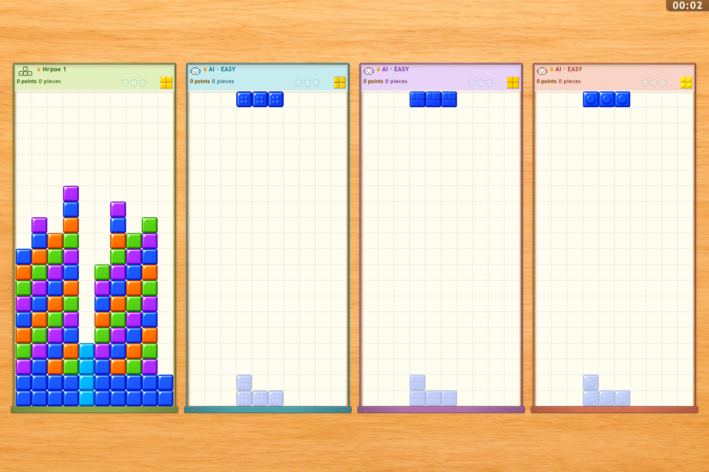
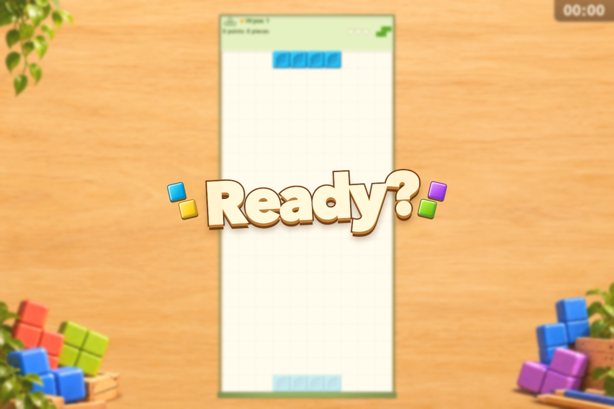
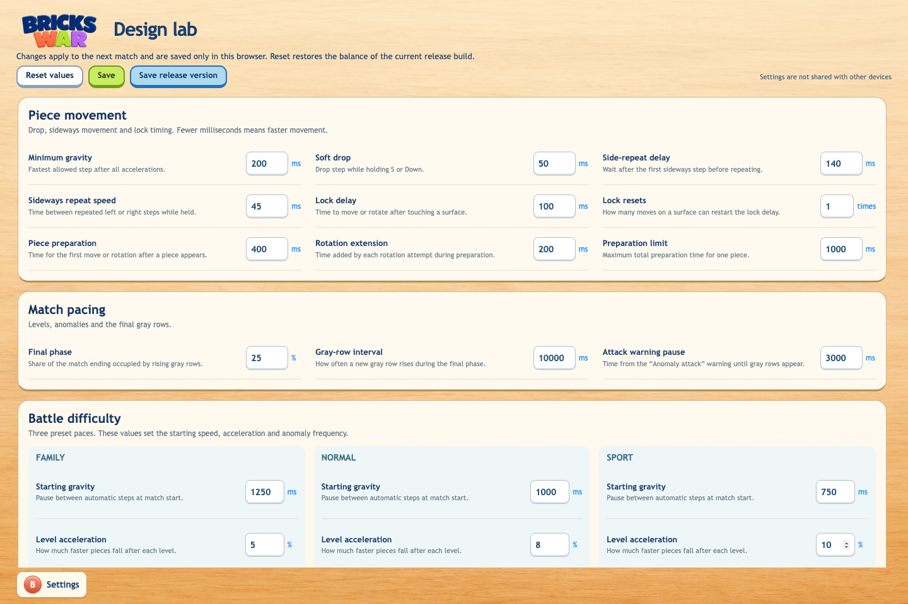

# Bricks War 1.14.0

## Русский

### Новое

- В настройках появился сброс локальных рекордов с подтверждением.

  

- После 4:45 серые ряды продолжают ускоряться: минус секунда каждые 30 секунд до интервала в одну секунду с 6:45.

  

- Глобальный рейтинг начинается заново под новые правила; старые клиенты и отложенные старые результаты не пополняют новую таблицу.

### Улучшения

- Заголовки полей получили цвета игроков, а фон локального командного боя разделён по командам.

  

  

- Вместо обратного отсчёта матч начинается с общей секундной надписи «Готовы?».

  

- Все параметры лаборатории собраны на одной прокручиваемой странице.

  

- Карточки выбора стиля фигур стали проще; активная карточка выделяется заметнее.

- Фокус в настройках и строки ползунков геймпада получили более мягкое оформление.

- Из списка сетевых комнат убрана лишняя кнопка настроек.

- Из главного меню убрана лишняя подсказка Select.

- Нижняя панель настроек паузы стала компактнее; подсказка возврата встроена в кнопку.

- Кнопки выбора страниц правил на телефоне стали крупнее.

- Правила листаются стрелками и пронумерованными темами.

- Настройки и справочные экраны используют общую светлую оболочку в стиле лобби.

- С экрана управления убраны пустая нижняя панель и лишняя внешняя рамка.

- Из лобби убрана лишняя подсказка подтверждения.

- Подсказки возврата в настройках и управлении встроены в кнопки.

- История обновлений прокручивается правым стиком; подсказка закрытия встроена в кнопку.

### Исправления

- Активный блок срабатывает сразу после завершения ряда.

- У ползунков настроек убрано лишнее подчёркивание.

- Навигация настроек корректно переходит между колонками разной длины.

- Плюс свободного места в режиме на очки выровнен по центру.

- Короткое нажатие X на выбранной карточке добавляет бота.

- Для неопознанных геймпадов используются понятные подсказки Xbox.

- Редактирование настроек с геймпада начинается после подтверждения.

- Стрелки геймпада напрямую переключают страницы правил.

- Музыка меню desktop-версии запускается без предварительного действия игрока.

## English

### Added

- Settings now offers a confirmed local-record reset.

  

- After 4:45, gray-row pressure keeps accelerating by one second every 30 seconds, down to a one-second interval at 6:45.

  

- The global leaderboard starts fresh for the new rules; older clients and old offline attempts cannot repopulate it.

### Improved

- Board headers use player colors, and local team battles have separate team backgrounds.

  

  

- Matches start with a shared one-second “Ready?” title instead of a numeric countdown.

  

- All Laboratory controls are on one scrolling page.

  

- Piece-style cards are simpler, with a clearer active-card highlight.

- Settings focus and gamepad slider rows use softer styling.

- Removed the redundant Settings shortcut from the network room list.

- Removed the redundant Select hint from the main menu.

- Pause Settings has a more compact footer with its Back hint inside the button.

- Phone rule-page selectors have larger touch targets.

- Rules use arrow paging and numbered topics.

- Settings and help sections share the light lobby-style shell.

- Removed the empty footer and redundant outer frame from Controls.

- Removed the redundant confirmation hint from the lobby.

- Settings and Controls Back hints appear inside their buttons.

- Release history scrolls with the right stick and has an inline close hint.

### Fixed

- Active defense triggers as soon as a line closes.

- Removed inherited underlines from Settings sliders.

- Settings navigation crosses columns of unequal length correctly.

- Centered the empty-slot plus in Survival.

- A short X press on the selected card adds a bot.

- Unrecognized controllers use Xbox button hints.

- Controller preference editing starts only after confirmation.

- Controller arrows directly change rule pages.

- Desktop menu music starts without an initial player gesture.

