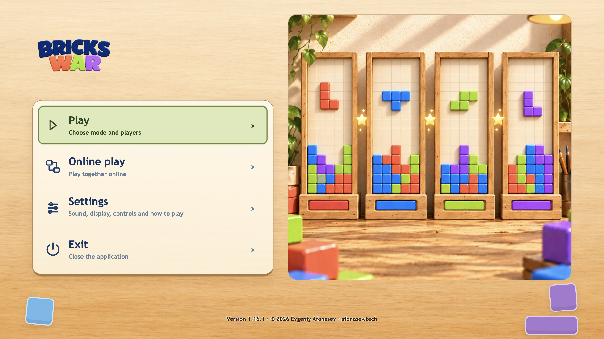

# Independent native migration 1.16.1

## Added
- Migrates the compatible 1.16.0 bridge to an independent launcher with signed launcher/client component updates and retained profile.

## Installation and verification
- Fresh installs use [1.16.0](https://github.com/afonasev/bricks-war/releases/tag/v1.16.0), then accept the in-game migration or run the 1.16.1 migration EXE manually. The Windows 1.16.1 EXE requires that existing all-users installation.
- [1.16.1](https://github.com/afonasev/bricks-war/releases/tag/v1.16.1) is stable, migration-only, and deliberately not GitHub latest. Source `180e8df5872c7d92d003e6276731ed5530760a81`; immutable public tag `d2254c641432cc5eca6714c03f92c870926bd213`.
- Actual macOS bridge replacement, signed production client identity, profile retention and offline restart passed. Controlled failed-start recovery passed with 91.4 seconds of real helper health waiting. Initial fault-fixture/harness FAIL is retained separately.
- Windows execution/UAC/alternate admin/ACL and human acceptance remain NotRun/deferred by the user. macOS distribution remains unsigned without notarization. Full game suite was not authorized or run.

Exact bytes are retained in the immutable GitHub release; compact QA records and original failures are retained by the maintainer. Web/content remains 1.15.1; the independent launcher change is native-only.

Slow connections can exceed the bridge's 120-second transfer deadline for the 381-MB Windows EXE. Download that EXE manually from the migration release and install over the existing 1.16.0 all-users installation. This is a recovery path, not Windows automatic-update acceptance.
