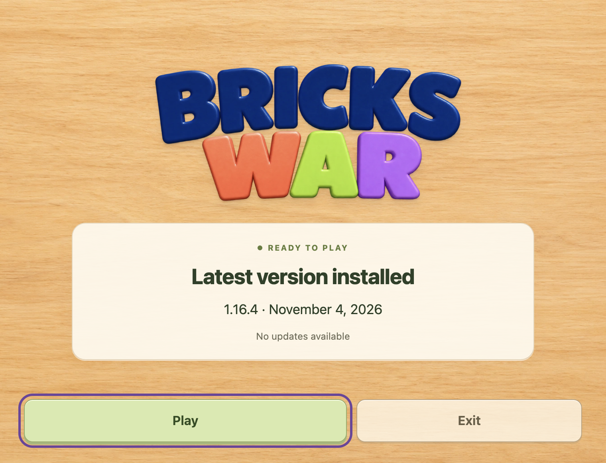
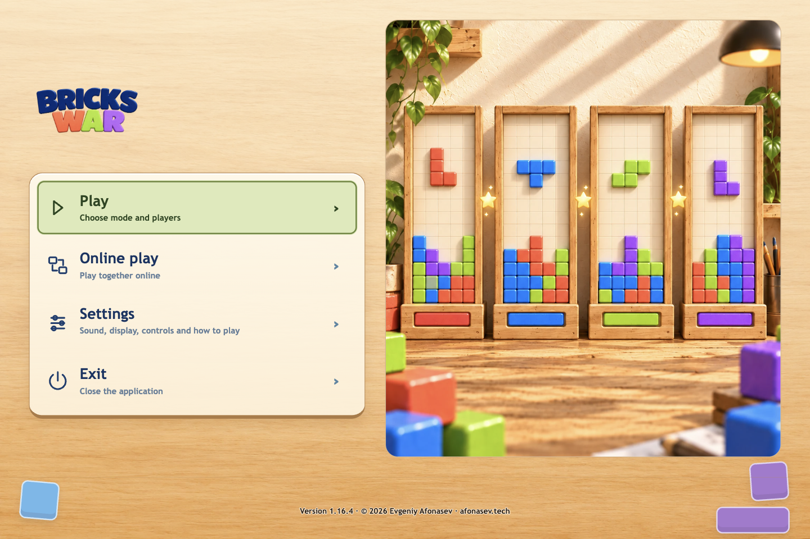

# Desktop launcher 1.16.4

## Improved
- Large game logo, warm workshop background and clear installed/new-version dates in the launcher.
- Play, Update when available, and Exit are grouped at the bottom of the launcher.

## Fixed
- Desktop game menus no longer show update announcements, download/error messages or update controls; update choices remain in the launcher.
- Historical update failures no longer claim that a previous version was restored.
- An already-consented handoff reaches game startup automatically; the next ordinary launch shows the launcher.

Fresh all-users bridge; native component release follows separately as 1.16.5. Existing signed transfer/cancellation and 90-second activation-health contracts remain. Windows/UAC and physical device acceptance are not established by source/macOS QA.
