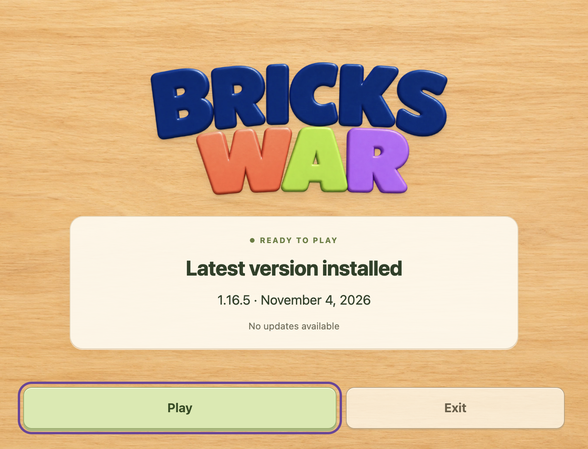
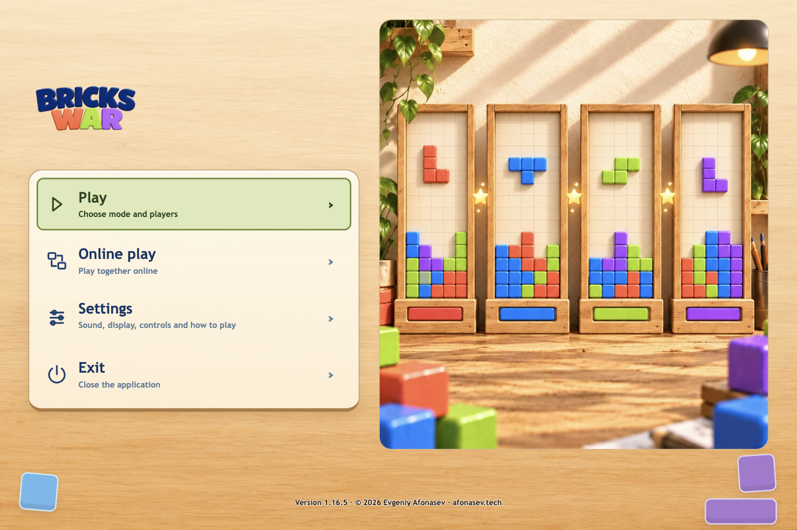

# Native launcher and client 1.16.5

## Improved
- The warm launcher with a large logo, version dates and bottom actions is delivered to existing native installations as a signed component update.

## Fixed
- Update availability, download progress and errors are shown in the launcher; desktop game menus contain no update messages or controls.
- Already-confirmed migration and native activation start the game automatically without a second Play click inside the health horizon.

Migration-only release; fresh installs use bridge 1.16.4. Signed bytes, cancellation and atomic recovery remain; the activation health horizon remains 90 seconds. Windows/UAC and physical acceptance remain separate and are not established by macOS packaging.
