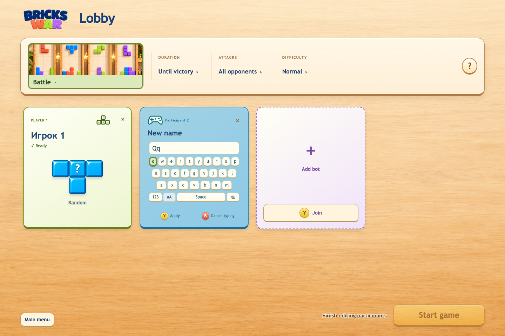
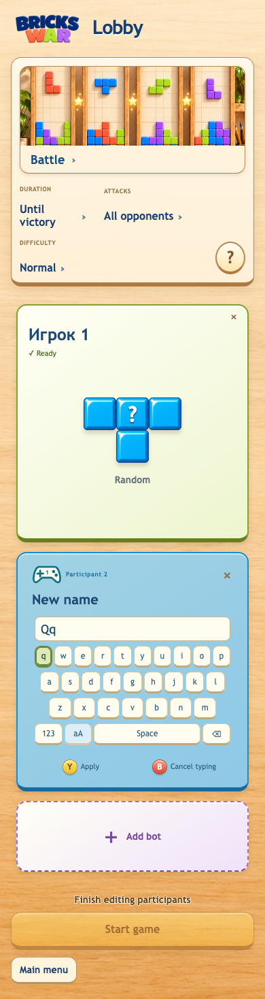

# Bricks War 1.16.6

## Русский

### Исправления

- На экранной клавиатуре геймпада можно вводить строчные и заглавные буквы компактной кнопкой `аА` (`aA` для латиницы).

- Подтверждение имени кнопкой Y, Enter или мышью сразу сохраняет его в историю, даже если затем отменить выбор стиля фигур.
- Новые имена и прежние имена после переименования профиля сохраняются в списке.
- Имена сортируются по последнему старту игры: недавно игравшие выше, давно не игравшие ниже.

## English

### Fixed

- Controller name entry supports lower and upper case through the compact `aA` key (`аА` for Cyrillic).

- Confirming a name with Y, Enter or the mouse saves it immediately, even if figure-style selection is then cancelled.
- New names and previous names from renamed profiles remain in saved history.
- Saved names are ordered by the most recent match start, with less recently used names below.

English screenshots are shared across release-note languages. Web and signed game-content release; existing installers remain unchanged. Physical-controller and Windows/UAC acceptance are separate from automated QA.
