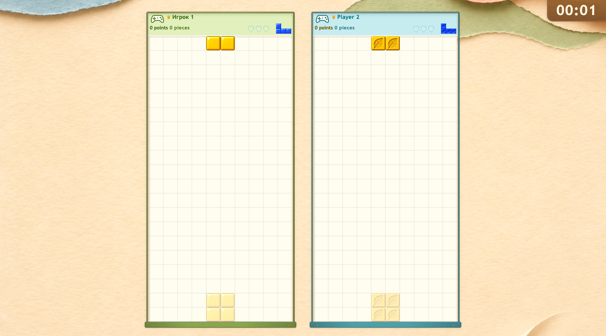
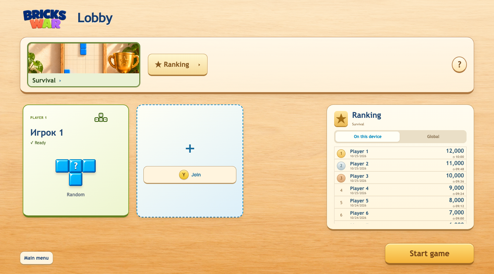
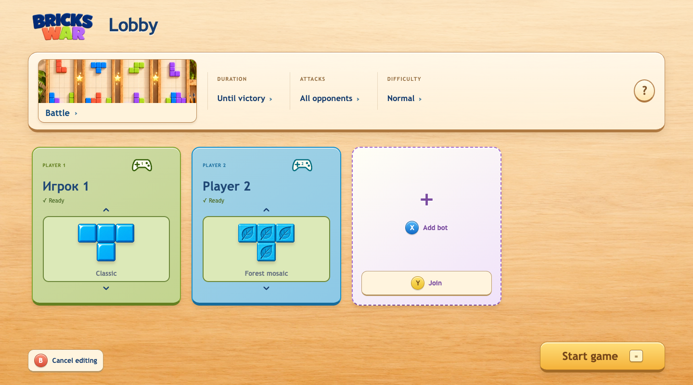

# Bricks War 1.16.7

## Русский

### Исправления

- Тема фигур применяется при переключении. A закрывает выбор и сохраняет тему, B возвращает прежнюю.
- Владелец локального лобби может начать матч, пока игроки выбирают темы. Каждый игрок получает тему со своей карточки.

- В режиме «Кто больше» рейтинг показывается справа при одном или двух игроках, если рядом с карточками хватает ширины. В низком окне список прокручивается внутри панели.

### Улучшения

- Добавлен отступ над фигурой в выборе темы, чтобы рамка фокуса не прилегала к рисунку.

### Баланс

- Правила и параметры баланса совпадают с версией 1.16.6.

## English

### Fixed

- Piece themes apply as you switch. A closes the picker and keeps the theme. B restores the previous theme.
- The local lobby owner can start while players are choosing themes. Each player gets the theme shown on their card.

- In Survival, the leaderboard appears on the right for one or two players when there is room beside the cards. In short windows, the list scrolls within the panel.

### Improved

- The theme picker leaves space above the piece so the focus outline clears the artwork.

### Balance

- Balance rules and settings match version 1.16.6.
