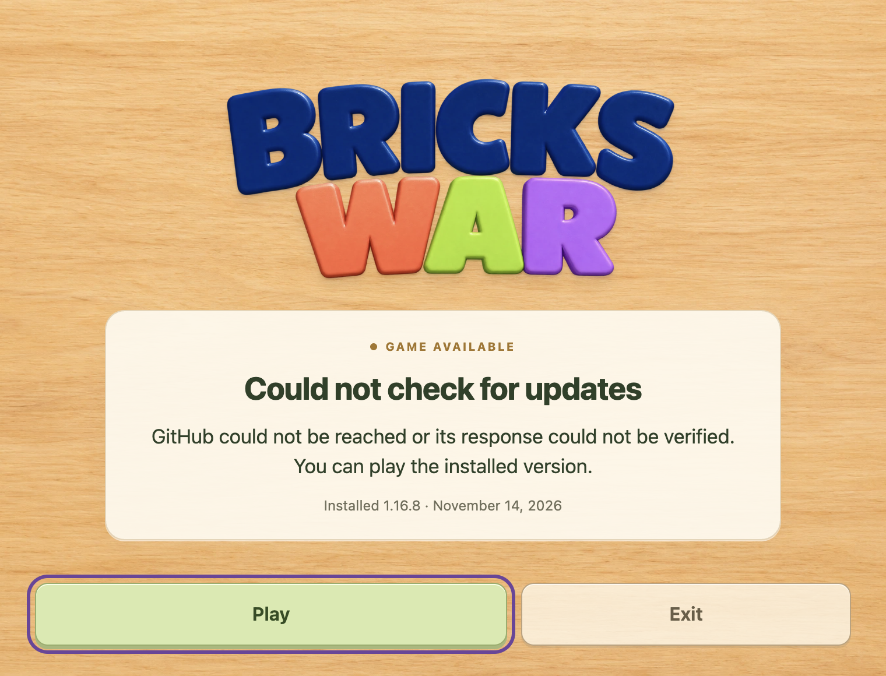
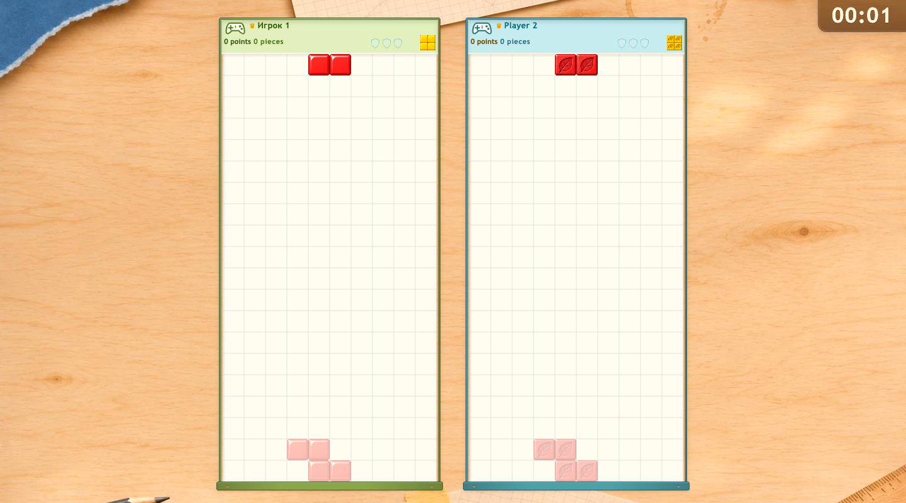
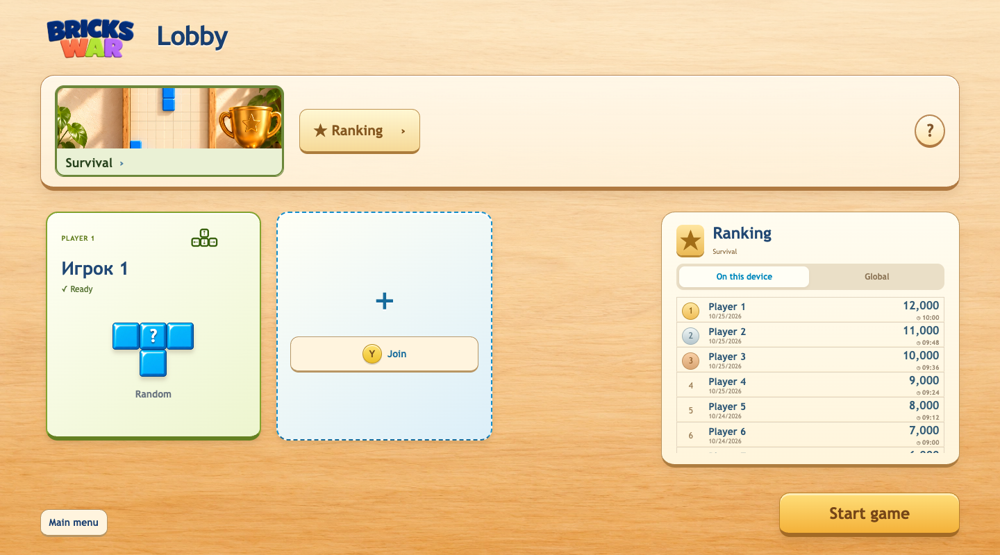
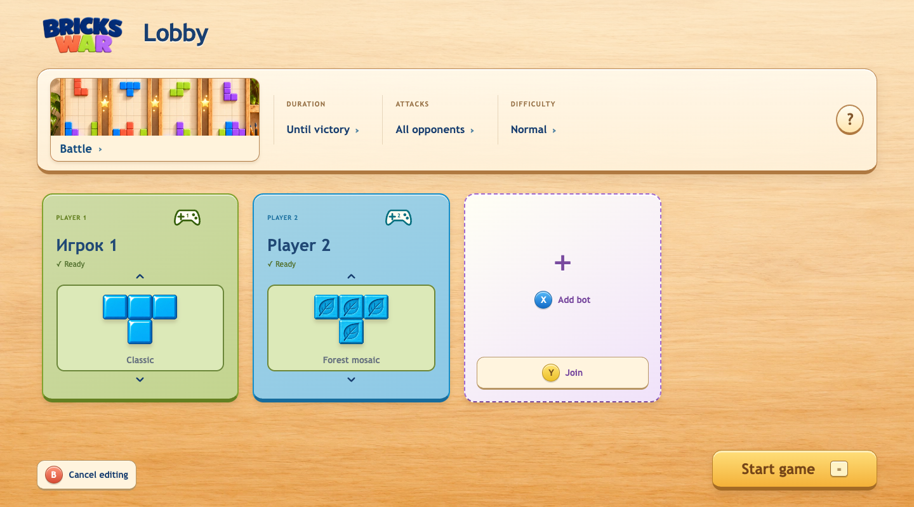

# Bricks War 1.16.8

## Русский

### Лаунчер

- Если GitHub недоступен или проверка занимает слишком много времени, лаунчер сообщает, что проверить обновления не удалось. Кнопка «Играть» запускает установленную версию.

### Игра

- Клавиатура геймпада поддерживает строчные и заглавные буквы.
- Подтверждённое имя сразу попадает в историю и сохраняется при отмене выбора темы.
- История имён сортируется по последнему запуску матча.
- Тема фигур применяется при переключении. A закрывает выбор, B возвращает предыдущую тему.
- Владелец локального лобби может начать матч с открытыми редакторами тем.

- Рейтинг режима «Кто больше» показывается справа, когда рядом с карточками хватает места.

- Между фигурой и верхней рамкой фокуса в выборе темы появился отступ.

### Баланс

- Правила и параметры баланса совпадают с предыдущим установщиком 1.16.4 и игровым контентом 1.16.7.

## English

### Launcher

- If GitHub is unreachable or the check times out, the launcher says it could not check for updates. Play opens the installed version.

### Game

- The controller keyboard supports lowercase and uppercase letters.
- Confirming a name saves it immediately. Cancelling theme selection keeps it in history.
- Name history is sorted by the most recent match start.
- Piece themes apply as you switch. A closes the picker. B restores the previous theme.
- The local lobby owner can start while theme pickers are open.

- The Survival leaderboard appears on the right when there is room beside the roster.

- The theme picker leaves space between the piece and the top of the focus outline.

### Balance

- Balance rules and settings match the previous 1.16.4 installer and 1.16.7 game content.
